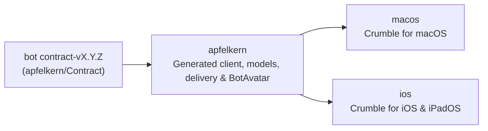

# Crumble for Apple platforms

Native macOS and iOS clients for Crumble and the Swift package they share.

| Directory | Contents |
| --- | --- |
| [`apfelkern`](apfelkern/README.md) | Shared Swift package: generated OpenAPI/SSE client, domain models, delivery state, and `BotAvatar`. |
| [`macos`](macos/README.md) | Crumble for macOS (SwiftUI package). |
| [`ios`](ios/README.md) | Crumble for iOS and iPadOS (Xcode project). |

Both apps depend on `../apfelkern` by path, so shared changes build and test with both apps in the same pull request.

## Continuous integration

Workflows in `.github/workflows` run only when their directory or `apfelkern` changes:

- `apfelkern.yml`: verifies the generated client, builds, tests, and lints `apfelkern`.
- `macos.yml`: runs `swift test` and `swiftlint` for the macOS app.
- `ios.yml`: builds the unsigned iOS app and test targets and runs `swiftlint` (simulator tests run locally).
- `apfelkern-update-contract.yml`: checks weekly for a new `bot` contract release and opens a verified pull request.

Canonical glossary and feature specifications live in [`crumble-project/spec`](https://github.com/crumble-project/spec).
