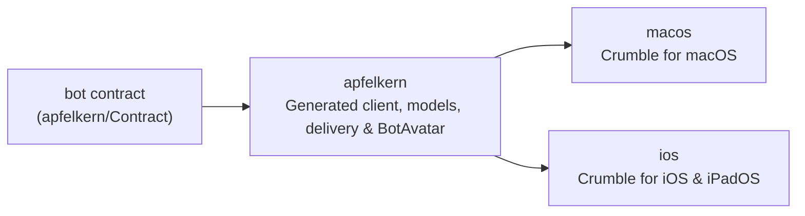

# Crumble for Apple platforms

Native macOS and iOS clients for Crumble and the Swift package they share.

| Directory | Contents |
| --- | --- |
| [`apfelkern`](apfelkern/README.md) | Shared Swift package: generated OpenAPI/SSE client, domain models, delivery state, and `BotAvatar` (avatars on Open Bot Avatar). |
| [`macos`](macos/README.md) | Crumble for macOS (SwiftUI package). |
| [`ios`](ios/README.md) | Crumble for iOS and iPadOS (Xcode project). |

Both apps depend on `../apfelkern` by path, so shared changes build and test with both apps in the same pull request.

## Continuous integration

Workflows in `.github/workflows` run only when their directory or `apfelkern` changes:

- `apfelkern.yml`: verifies the generated client, builds, tests, and lints `apfelkern`.
- `macos.yml`: runs `swift test` and `swiftlint` for the macOS app.
- `ios.yml`: builds the unsigned iOS app and test targets and runs `swiftlint` (simulator tests run locally).

## Releases

A `vMAJOR.MINOR.PATCH` tag runs `release.yml`, which releases both apps at that version. MINOR and PATCH stay below 100, and the build number is `MAJOR×10000 + MINOR×100 + PATCH`.

- **macOS:** `macos/scripts/release.sh` signs `Crumble.app` with Developer ID, notarizes and staples it, and the workflow attaches `Crumble-VERSION-macOS.zip` to a GitHub release.
- **iOS:** `ios/scripts/release.sh` archives the app and uploads it to App Store Connect, where it becomes a TestFlight build. Xcode signs it with a cloud-managed distribution certificate.

Both scripts also run locally with the same environment variables. The workflow needs these repository secrets:

| Secret | Contents |
| --- | --- |
| `APP_STORE_CONNECT_KEY_ID` | Key ID of an App Store Connect API key with the Admin role |
| `APP_STORE_CONNECT_ISSUER_ID` | The API key's issuer ID |
| `APP_STORE_CONNECT_KEY_BASE64` | The key's `.p8` file, base64-encoded |
| `DEVELOPER_ID_CERTIFICATE_BASE64` | A Developer ID Application certificate and its private key as a `.p12`, base64-encoded |
| `DEVELOPER_ID_CERTIFICATE_PASSWORD` | The `.p12` password |

The app `ng.crumbli.ios` must exist in App Store Connect before the first upload.

The canonical glossary is [`bot/GLOSSARY.md`](https://github.com/crumble-project/bot/blob/main/GLOSSARY.md).

## License

Licensed under the [GNU Affero General Public License v3.0](LICENSE) (`AGPL-3.0-only`). Third-party components retain their respective licenses.
